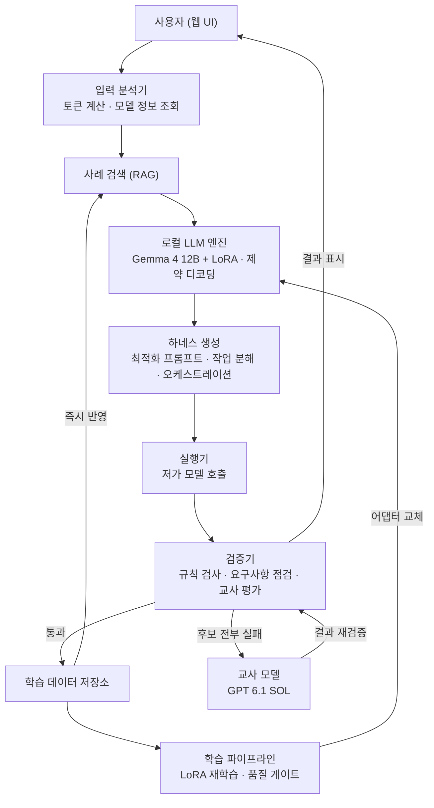

# LocalHarnessMaker

GPT 6.1 SOL의 증류를 통해 Gemma 4 12B로 개발자를 위한 프로젝트 하네스 생성을 자동화하는 모델을 개발합니다.

> **현재 상태: 기획·설계 단계**
> 아직 실행 가능한 코드는 포함되어 있지 않습니다. 설치 및 사용 방법은 구현이 진행되는 대로 추가할 예정입니다.

> **현재 진행 방향 (2026-10-14)**
> Codex에 요청을 전달하기 전 로컬 LLM이 필요한 질문, 요구사항 구체화, 기술 제안을 수행해 첫 결과물의 품질을 높이고 사용자 수정 횟수를 줄이는 방향으로 범위를 정리했습니다.
> 먼저 GPT 6.1 SOL로 개발 실험과 결과물 블라인드 평가를 수행해 효과를 확인하고, 검증된 판단을 Gemma 4 12B에 증류합니다. 실험은 아직 실행하지 않았습니다.
> 최신 목표, 실험 프로토콜, 진행 순서와 이어서 작업할 맥락은 **[docs/README.md](docs/README.md)**에서 확인하세요. 아래 본문은 초기 하네스 생성 설계이며, 현재 방향과 다른 내용은 `docs/`의 상태 구분에 따라 읽습니다.
> **입력 준비:** 지정 교사 모델로 프로젝트 원본 2개와 A~E 요청 10개를 생성·검토했습니다. [파일럿 자료](experiments/pilot-v1/README.md)와 [준비 보고서](docs/experiments/pilot-v1-preparation.md)를 참조하세요. 실제 개발·블라인드 평가는 아직 실행하지 않았습니다.

## 목차

- [프로젝트 개요](#프로젝트-개요)
- [하네스란](#하네스란)
- [핵심 기능](#핵심-기능)
- [시스템 구조](#시스템-구조)
- [순환 증류](#순환-증류)
- [모델 구성](#모델-구성)
- [기대 효과](#기대-효과)
- [개발 로드맵](#개발-로드맵)
- [고려 사항](#고려-사항)

## 프로젝트 개요

### 배경

고성능 LLM은 결과 품질이 뛰어나지만 토큰 비용이 높아, 반복적이거나 대량의 요청을 처리해야 하는 소규모 개발팀과 개인 개발자에게 큰 부담이 됩니다. 비용을 줄이려고 저비용 모델로 바꾸면 다음과 같은 문제가 생깁니다.

- 추상적인 표현이나 여러 지시가 섞인 프롬프트에서 조건을 빠뜨리기 쉽습니다.
- 복잡한 작업을 한 번에 처리하면 결과 품질이 불안정해집니다.
- 어떤 작업을 단일 모델로 처리하고 어떤 작업을 여러 모델로 나눌지 판단하려면 프롬프트 설계와 오케스트레이션 경험이 필요합니다.

결국 저비용 모델을 제대로 쓰려면 모델을 감싸는 "실행 틀"을 잘 설계해야 하는데, 이 설계 자체가 많은 시간과 노하우를 요구합니다.

### 목표

저비용 모델로도 일정 수준 이상의 결과 품질을 안정적으로 얻을 수 있도록, **작업에 맞는 하네스를 자동으로 생성하는 로컬 모델**을 만드는 것이 목표입니다.

하네스 생성까지 고성능 모델에 맡기면 비용 문제가 그대로 남습니다. 그래서 이 역할은 로컬에서 실행되는 소형 모델(Gemma 4 12B)이 담당하고, 고성능 모델(GPT 6.1 SOL)은 소형 모델을 가르치는 교사 역할로만 제한적으로 사용합니다.

### 예상 사용자

- AI 사용 비용에 부담을 느끼는 소규모 개발팀과 개인 개발자
- 프롬프트 작성이나 멀티 모델 구성에 익숙하지 않지만, 빠르게 AI 기능을 만들어야 하는 개발자

### 활용 상황

고성능 모델의 비용 때문에 저비용 모델을 써야 하지만, 결과 품질은 일정 수준 이상으로 확보해야 하는 상황에서 사용합니다.

## 하네스란

이 프로젝트에서 하네스(harness)는 **저가 모델이 작업을 안정적으로 수행하도록 감싸는 실행 틀**을 뜻합니다. LocalHarnessMaker는 사용자의 요청을 받아 아래 구성 요소를 한 번에 생성합니다.

| 구성 요소 | 설명 |
| --- | --- |
| 최적화 프롬프트 | 모호한 표현을 구체화하고, 필요한 조건과 맥락을 명시한 프롬프트 |
| 작업 분해 | 복잡한 요청을 저가 모델이 처리하기 쉬운 단계로 나눈 구성 |
| 오케스트레이션 | 단계별 담당 모델, 역할(생성·검증·수정 등), 실행 순서 |
| 검증 기준 | 원본 요청에서 추출한 요구사항 목록으로, 결과가 조건을 충족했는지 판단하는 기준 |

## 핵심 기능

### 1. 저가 모델을 위한 프롬프트 자동 최적화

사용자가 작성한 프롬프트의 의도와 작업 조건을 분석해, 저가 모델에서도 높은 품질의 결과를 낼 수 있도록 구체적이고 명확한 형태로 재작성합니다. 불필요한 토큰은 줄이고, 필요한 조건과 맥락은 유지합니다.

- **입력**: 사용자가 작성한 원본 프롬프트
- **처리**: 요청 목적, 조건, 출력 형식을 분석하고 모호한 표현을 수정
- **출력**: 저가 모델에 최적화된 프롬프트

### 2. 복잡하거나 추상적인 프롬프트 구조화

프롬프트 안의 추상적인 표현, 복합 지시, 부족한 조건을 찾아내고, 하나의 복잡한 요청을 명확한 단계별 작업으로 분리합니다.

- **입력**: 추상적이거나 여러 요구사항이 섞인 프롬프트
- **처리**: 요구사항 분리, 조건 구체화, 작업 순서 정리
- **출력**: 단계별로 구조화된 명확한 프롬프트

### 3. 작업에 적합한 오케스트레이션 제안

작업의 난이도와 유형을 분석해 단일 모델로 충분한지 판단하고, 필요하면 생성·검증·수정 역할을 여러 모델에 나눠 맡기는 실행 구조를 제안합니다. 예를 들어 첫 번째 모델이 초안을 만들고, 두 번째 모델이 오류와 누락을 검토한 뒤, 최종 결과를 수정하는 구조를 만들 수 있습니다.

- **입력**: 작업 요청과 사용 가능한 모델 정보
- **처리**: 작업 난이도 분석, 모델 역할 분배, 처리 순서 설계
- **출력**: 모델별 역할과 실행 순서가 포함된 오케스트레이션 구성

## 시스템 구조

시스템은 하네스를 생성하는 **서비스 영역**과, 실행 결과를 검증해 로컬 모델을 계속 개선하는 **학습 영역**으로 나뉩니다.



### 구성 요소

| 영역 | 구성 요소 | 역할 |
| --- | --- | --- |
| 서비스 | 웹 UI | 프롬프트 입력, 분석·최적화 결과 비교, 오케스트레이션 확인 및 실행 |
| 서비스 | 입력 분석기 | 토큰 수 계산, 모델별 비용·사양 조회 등 규칙으로 처리할 수 있는 사실 정보 수집 |
| 서비스 | 사례 라이브러리 | 검증된 하네스 사례를 저장하고, 유사 사례를 검색해 로컬 LLM에 예시로 제공 |
| 서비스 | 로컬 LLM 엔진 | LoRA 어댑터를 적용한 로컬 모델로 하네스를 생성하고, 제약 디코딩으로 출력 스키마를 강제 |
| 서비스 | 실행기 | 생성된 하네스에 따라 저가 모델을 호출하고, 오케스트레이션 순서대로 결과를 연결 |
| 공통 | 검증기 | 실행 결과를 규칙 검사, 요구사항 점검, 교사 모델 평가로 판정 |
| 학습 | 교사 모델 연동 | 초기 데이터 생성, 로컬 모델이 실패한 사례 처리, 결과 품질 평가 |
| 학습 | 학습 데이터 저장소 | 검증을 통과한 데이터를 누적 저장하고 버전 관리 |
| 학습 | 학습 파이프라인 | 누적 데이터로 LoRA를 재학습하고, 고정 평가셋 비교를 통과한 어댑터만 배포 |

### 설계 원칙

소형 모델은 정해진 형식을 채우는 일에는 강하지만, 긴 맥락을 읽고 스스로 계획을 세우는 일에는 약합니다. 그래서 어려운 부분을 모델 밖으로 분리해, 모델은 좁고 검증 가능한 판단에만 집중하도록 설계합니다.

- **출력 공간 축소**: 모델은 자유 텍스트 대신 정해진 스키마로만 출력하고, 제약 디코딩(constrained decoding)으로 형식 오류를 원천 차단합니다.
- **사실과 판단의 분리**: 토큰 수, 모델별 비용·사양 같은 사실 정보는 코드와 설정 파일이 제공하고, 모델은 판단만 맡습니다.
- **예시 기반 일반화**: 검증된 사례 라이브러리에서 유사 사례를 검색(RAG)해 함께 제공하므로, 처음 보는 유형의 요청에도 대응할 수 있습니다.
- **실행 기반 검증**: 생성된 하네스로 저가 모델을 실제로 실행하고, 그 결과로 품질을 판단합니다.

### 하네스 출력 스키마 (초안)

> 설계 단계의 예시이며, 구현 과정에서 변경될 수 있습니다.

```json
{
  "task_summary": "요청의 목적과 최종 결과물 형태",
  "requirements": [
    "원본 요청에서 추출한 조건 1",
    "원본 요청에서 추출한 조건 2"
  ],
  "steps": [
    {
      "id": 1,
      "role": "generate",
      "model": "<cheap-model-a>",
      "prompt": "1단계에서 저가 모델에 전달할 프롬프트"
    },
    {
      "id": 2,
      "role": "review",
      "model": "<cheap-model-b>",
      "prompt": "1단계 결과의 오류와 누락을 검토하는 프롬프트",
      "depends_on": [1]
    }
  ],
  "estimated_cost": {
    "input_tokens": 0,
    "output_tokens": 0
  }
}
```

## 순환 증류

한 번 증류하고 끝내지 않고, **실행 결과가 곧 정답 라벨이 되는 순환 루프**로 로컬 모델을 계속 개선합니다. 이론적으로는 전문가 반복(expert iteration) 계열의 자기개선 학습 구조입니다.

### 초기 단계 (1차 증류)

교사 모델(GPT 6.1 SOL)로 초기 학습 데이터를 만들고, 검증을 통과한 데이터만으로 Gemma 4 12B에 1차 QLoRA 학습을 진행합니다.

### 반복 단계

1. 로컬 모델이 하나의 요청에 대해 하네스 후보를 N개 생성합니다.
2. 각 후보로 저가 모델을 실제 실행하고, 검증기가 결과를 평가합니다.
3. 검증을 통과한 결과는 학습 데이터로 축적합니다.
4. N개 후보가 모두 실패한 어려운 사례만 교사 모델에 넘기고, 교사의 결과도 검증을 통과한 경우에만 저장합니다.
5. 축적된 데이터로 주기적으로 LoRA를 재학습하고, 품질 게이트를 통과하면 기존 어댑터와 교체합니다.

로컬 모델이 성장할수록 교사 모델을 부르는 횟수가 줄어, 운영 비용도 함께 줄어듭니다.

### 검증 방식

| 방식 | 내용 |
| --- | --- |
| 규칙 검사 | 출력 형식과 필수 조건 포함 여부를 코드로 확인 |
| 요구사항 충족 점검 | 원본 요청에서 추출한 요구사항별로 충족 여부 확인 |
| 교사 모델 평가 | 교사 모델이 기준표(rubric)에 따라 결과 품질을 평가 (LLM-as-judge) |
| 비용 측정 | 토큰 사용량과 비용을 함께 기록 |
| 사람 검수 | 일부 샘플을 직접 검수해, 평가 모델 기준에만 맞추는 보상 해킹(reward hacking)을 방지 |

### 운영 원칙

- **두 가지 속도의 업데이트**: 검증된 사례는 사례 라이브러리에 즉시 반영하고(빠른 루프), LoRA는 주기적으로 재학습합니다(느린 루프).
- **망각 방지**: 새 데이터로만 이어서 학습하지 않고, 매번 베이스 모델에서 누적 데이터 전체로 재학습합니다.
- **품질 게이트**: 고정 평가셋에서 기존 어댑터보다 나을 때만 교체하고, 어댑터 버전을 관리해 언제든 롤백할 수 있게 합니다.
- **모델 붕괴 방지**: 자기 출력만 반복 학습하지 않도록 교사 데이터 비율을 일정 수준 유지하고, 중복 데이터를 제거합니다.
- **핵심 자산**: 어댑터가 아니라 검증 데이터셋과 검증기를 핵심 자산으로 관리합니다. 베이스 모델이 바뀌어도 데이터셋만 있으면 다시 학습할 수 있습니다.

## 모델 구성

| 구분 | 모델 | 역할 | 호출 시점 |
| --- | --- | --- | --- |
| 로컬 LLM | Gemma 4 12B + LoRA | 요청 분석, 프롬프트 최적화·구조화, 오케스트레이션 설계 등 하네스 생성 | 매 요청 |
| 저가 모델 | 사용자가 선택한 저비용 API 모델 | 하네스에 따라 실제 작업 수행 | 실행·검증 단계 |
| 교사 모델 | GPT 6.1 SOL | 초기 학습 데이터 생성, 실패 사례 처리, 결과 품질 평가 | 학습·검증 단계 (필요할 때만) |

판단은 로컬 LLM, 실행은 저가 모델, 기준 제시는 교사 모델이 맡아 각 모델을 비용 대비 가장 효율적인 지점에 배치합니다.

## 기대 효과

- **비용 절감**: 하네스 생성은 로컬 모델이 맡고 고성능 모델은 학습과 평가에만 쓰므로, 요청마다 고성능 모델을 호출하는 비용이 들지 않습니다.
- **품질 안정화**: 프롬프트 최적화, 작업 분해, 검증 단계를 거쳐 저가 모델의 조건 누락과 품질 편차를 줄입니다.
- **진입 장벽 완화**: 프롬프트 설계나 멀티 모델 구성 경험이 없어도 바로 쓸 수 있는 실행 구조를 얻을 수 있습니다.
- **지속적인 개선**: 사용할수록 검증된 데이터가 쌓여 로컬 모델이 계속 좋아집니다.

## 개발 로드맵

| 주차 | 단계 | 주요 작업 |
| --- | --- | --- |
| 1주차 | 기획·요구사항 | 문제 정의, 핵심 기능 정의, 기능별 입력·처리·출력 정의, 저가 LLM 후보 조사, 기술 스택 결정 |
| 2주차 | 설계·프로토타입 | 시스템 아키텍처 설계, 출력 형식 정의, 교사 데이터 생성·검증 파이프라인 설계, 고정 평가셋 구성 |
| 3주차 | 핵심 구현 1 | 프롬프트 분석·최적화·구조화 구현, 교사 모델로 초기 데이터 생성(1차 증류), LoRA 1차 학습 |
| 4주차 | 핵심 구현 2·통합 | 난이도 분석, 오케스트레이션(생성 → 검증 → 수정) 구현, 기능 통합, 순환 증류 루프 실행 및 재학습 |
| 5주차 | 테스트·최종 결과물 | 유형별 프롬프트 테스트, 고성능·저가 모델 결과 비교, 비용 비교, 증류 전후 성능 비교, 문서화 |
| 6주차 | 발표 | 발표 자료와 데모 준비, 최종 발표 |

## 고려 사항

- 교사 모델의 출력물을 학습에 사용하는 것이 제공사 이용 약관에 부합하는지 확인합니다.
- 사용자 프롬프트를 학습 데이터로 저장할 경우 사전 동의를 받고, 개인정보와 민감 정보를 제거한 뒤 저장합니다.
- 교사 모델 평가의 편향을 줄이기 위해 규칙 기반 검사와 사람 검수를 함께 사용합니다.
